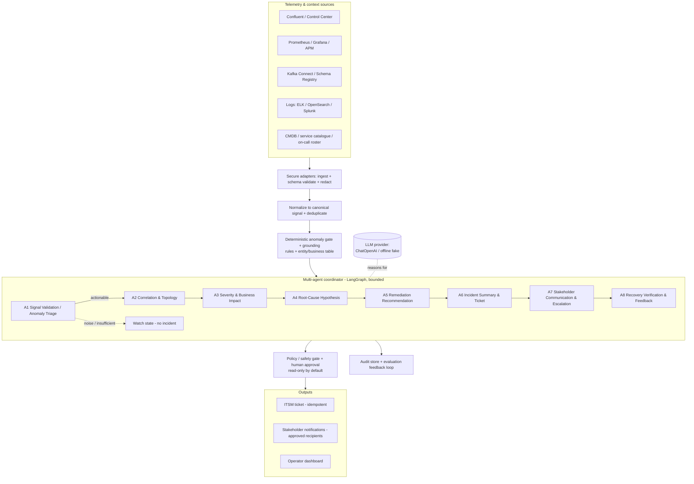
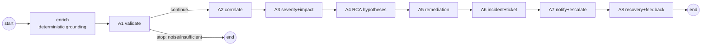
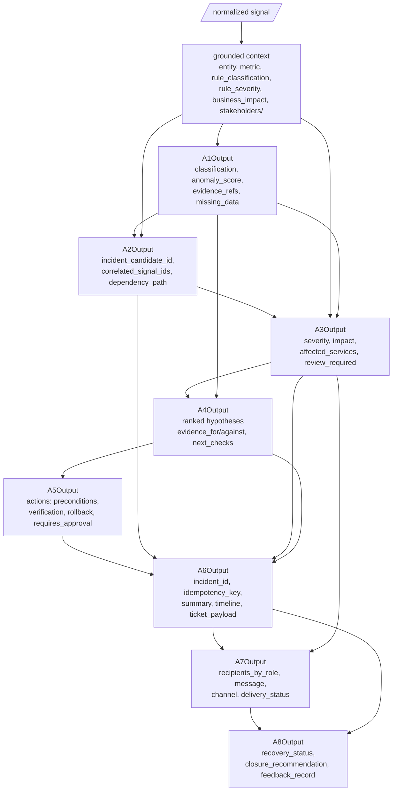

# Architecture & Data Flow — Multi-Agent Sentinel (A1–A8)

**Project:** EventHub Ops – Sentinel
**Scope:** The A1–A8 multi-agent pipeline (requirements §7), built on **LangChain + LangGraph**.
Implemented in `agent/agents/`; run via `scripts/run_multiagent.py`.

> Design principle (Phase 1): **agents analyze and coordinate; deterministic controls enforce
> policy.** The LLM reasons over a grounded context; code enforces thresholds, severity floors,
> approved recipients, idempotency, and human approval for actions.

---

## 1. High-level architecture

**Notes**
- `GATE` builds the grounded context once (classification, thresholds, business impact,
  stakeholders) — the deterministic half the agents cannot override.
- `COORD` is the LangGraph state machine. Each A-node is a separate agent with its own prompt and
  typed output contract.
- `POLICY` keeps the system read-only by default; A5 actions always carry `requires_approval`.
- The `LLM` is a reasoning component only; it never sources metrics, recipients, or authorization.

---

## 2. Agent pipeline & gate (LangGraph topology)

This matches `agent/agents/orchestrator.py`: `enrich → A1 → (conditional) → A2…A8 → END`, with the
A1 gate short-circuiting to END for `noise`/`insufficient_evidence` (observed live: trace `A1` only).

---

## 3. Data-flow — typed contracts passed between agents

Each agent consumes the grounded context plus selected upstream outputs, and emits a typed
contract (`agent/agents/contracts.py`). Shared `IncidentState` carries them.

---

## 4. Per-agent contract & guardrail summary (requirements §7)

| Agent | Key outputs | Deterministic guardrail enforced in code |
|-------|-------------|------------------------------------------|
| A1 | classification, anomaly_score, evidence_refs, missing_data | critical-tier confirmed/likely not downgraded to noise; gate stops noise/insufficient |
| A2 | incident_candidate_id, correlated_signal_ids, dependency_path | originating signal id always preserved in correlation |
| A3 | severity, impact, affected_services, review_required | severity floor = deterministic rule severity for critical tier; review_required set |
| A4 | ranked hypotheses (evidence for/against), next_checks | (prompt) no single confirmed cause without evidence |
| A5 | actions (preconditions/verification/rollback) | read_only forced true; every action requires_approval |
| A6 | incident_id, idempotency_key, summary, ticket_payload | deterministic idempotency key; no secrets |
| A7 | recipients_by_role, message, channel, delivery_status | recipients ONLY from approved table; delivery_status=not_sent |
| A8 | recovery_status, closure_recommendation, feedback_record | no "recovered" without post-action telemetry (alert gone ≠ recovered) |

---

## 5. Provider & execution

- **Production:** OpenAI `ChatOpenAI` (`SENTINEL_LLM=openai`, `OPENAI_API_KEY`).
- **Offline verification:** deterministic fake chat model serves per-agent responses keyed on an
  `AGENT_ID` marker, so the full graph + guardrails run without a key.
- **Run:** `python scripts/run_multiagent.py --batch data/evaluation/phase2_demo_inputs.txt`
  (logs each incident to `logs/mcp_events.log` with the agent trace and per-agent outputs).

Rendered diagrams: `docs/diagrams/architecture.svg`, `docs/diagrams/dataflow.svg`.
