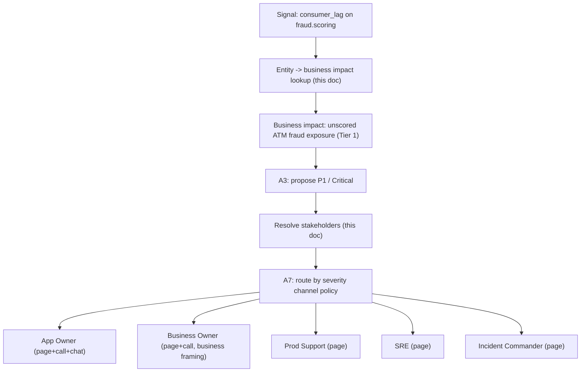

# Events → Business Impact → Stakeholder Summary

**Project:** EventHub Ops – Sentinel
**Phase 1 artifact** — the business-context input used for alerting. It maps a Kafka entity
(topic / consumer group / connector / cluster) to the affected **business services**, the
**business impact**, and the **stakeholders to alert**.

> **All data below is illustrative placeholder data (PII-safe).** No real names, emails, or
> channels. In production these mappings are sourced from the **CMDB, service catalogue, and
> on-call roster** (requirements §3, FR-04, FR-11, open decision §17) with freshness and
> provenance metadata. Sentinel never guesses a recipient — it resolves only from the approved
> directory.

---

## 1. Why this document exists

When a signal arrives, its `entity.id` (from the canonical schema in `inputs.md`) must be
translated into two business-critical answers:

1. **What breaks for the business?** (e.g., payments delayed, card authorization failing, fraud exposure)
2. **Who must be told, and how?** (App Owner, Business Owner, Prod Support, SRE, on-call)

This mapping lets:
- **A3 (Severity & Business Impact)** ground severity in real business criticality.
- **A6 (Incident Summary & Ticket)** write an incident summary with business impact.
- **A7 (Stakeholder Communication & Escalation)** route notifications to the right people/channels.

---

## 2. Entity → business impact mapping (placeholder)

| Kafka entity (type:id) | Business service(s) | Business capability | Business impact if degraded | Criticality tier |
|------------------------|---------------------|---------------------|------------------------------|------------------|
| `topic:payments.settlement` | Payments Settlement | Interbank/payment settlement | Payments delayed or failed; settlement backlog; SLA/regulatory risk | Tier 1 (critical) |
| `topic:cards.authorization` | Card Authorization | Real-time card auth | Card authorization failures; declined transactions at POS/ecom | Tier 1 (critical) |
| `topic:atm.withdrawals` | ATM Services | Cash withdrawal + reconciliation | Withdrawal retractions/reversals; customer cash disputes | Tier 1 (critical) |
| `consumer_group:fraud.scoring` | Fraud Detection | Real-time fraud scoring | Fraud possibility in ATM/card transactions goes unscored; exposure window | Tier 1 (critical) |
| `topic:trades.execution` | Trading / Markets | Trade execution + capture | Trade transactions delayed; order capture gaps; market risk | Tier 1 (critical) |
| `topic:ledger.updates` | Core Ledger | Posting to ledger | Ledger updates delayed; balance/statement inconsistency | Tier 1 (critical) |
| `connector:crm.sink` | Customer Notifications | Alerts/notifications | Customer notifications delayed; reduced service quality | Tier 2 (high) |
| `topic:analytics.events` | Analytics / Reporting | Batch analytics | Reporting lag; no direct customer impact | Tier 3 (medium) |

> Criticality tiers are placeholders aligned to the bank's P1–P4 severity policy; the authoritative
> tiering lives in the service catalogue. A high-criticality entity is never downgraded merely
> because model confidence is low (see `success_criteria.md`).

---

## 3. Stakeholder routing mapping (placeholder)

Recipients and channels per entity. Channels follow role + severity (see §4).

| Kafka entity (type:id) | App Owner | Business Owner | Prod Support team | SRE | On-call / escalation |
|------------------------|-----------|----------------|-------------------|-----|----------------------|
| `topic:payments.settlement` | payments-app-owner@example.com | payments-biz-owner@example.com | prodsupport-payments@example.com | sre-streaming@example.com | pager: payments-oncall / `#inc-payments` |
| `topic:cards.authorization` | cards-app-owner@example.com | cards-biz-owner@example.com | prodsupport-cards@example.com | sre-streaming@example.com | pager: cards-oncall / `#inc-cards` |
| `topic:atm.withdrawals` | atm-app-owner@example.com | atm-biz-owner@example.com | prodsupport-atm@example.com | sre-streaming@example.com | pager: atm-oncall / `#inc-atm` |
| `consumer_group:fraud.scoring` | fraud-app-owner@example.com | fraud-biz-owner@example.com | prodsupport-fraud@example.com | sre-ml@example.com | pager: fraud-oncall / `#inc-fraud` |
| `topic:trades.execution` | trades-app-owner@example.com | trades-biz-owner@example.com | prodsupport-trades@example.com | sre-streaming@example.com | pager: trades-oncall / `#inc-trades` |
| `topic:ledger.updates` | ledger-app-owner@example.com | ledger-biz-owner@example.com | prodsupport-ledger@example.com | sre-streaming@example.com | pager: ledger-oncall / `#inc-ledger` |
| `connector:crm.sink` | crm-app-owner@example.com | crm-biz-owner@example.com | prodsupport-crm@example.com | sre-integration@example.com | `#inc-notifications` |
| `topic:analytics.events` | analytics-app-owner@example.com | analytics-biz-owner@example.com | prodsupport-analytics@example.com | sre-data@example.com | `#inc-analytics` (digest) |

---

## 4. Channel policy by severity (placeholder)

| Severity | App Owner | Business Owner | Prod Support | SRE | Incident Commander |
|----------|-----------|----------------|--------------|-----|--------------------|
| P1 / Critical | Page + call + chat | Page + call | Page | Page | Page immediately |
| P2 / High | Page + chat | Email + chat | Page | Chat | Notify |
| P3 / Medium | Chat | Email | Ticket + chat | Chat | — |
| P4 / Low | Email / digest | Digest | Ticket / digest | Digest | — |

Business Owners receive **business-impact-framed** messages (what the customer/business
experiences); technical teams receive **evidence-framed** messages (what the signals show).

---

## 5. Worked example — impacted topic to full alert chain

**Scenario:** rising `consumer_lag` on `consumer_group:fraud.scoring` reading from
`topic:atm.withdrawals`.

1. **Signal in (inputs.md):** `entity = {type: consumer_group, id: fraud.scoring}`, `metric_or_event = consumer_lag`, `value = 125000 messages`, `environment = prod`.
2. **Entity → business impact (this doc §2):** Fraud Detection service; real-time fraud scoring; **business impact = fraud possibility in ATM transactions goes unscored** (exposure window); Tier 1.
3. **Severity (A3):** combines Tier 1 criticality + growing lag + fraud exposure → proposes **P1 / Critical** with rationale and confidence.
4. **Stakeholders (this doc §3):** resolve recipients for `fraud.scoring`:
   - App Owner: fraud-app-owner@example.com
   - Business Owner: fraud-biz-owner@example.com
   - Prod Support: prodsupport-fraud@example.com
   - SRE: sre-ml@example.com
   - On-call/escalation: pager fraud-oncall, `#inc-fraud`, Incident Commander
5. **Channels (this doc §4, P1):** page + call + chat for App Owner; page + call for Business Owner; page for support/SRE; page Incident Commander immediately.
6. **A6 incident summary** includes the business impact line ("fraud scoring delayed on ATM withdrawals — potential unscored fraud exposure").
7. **A7 sends** business-impact-framed message to Business Owner, evidence-framed message to technical teams, each on the P1 channels above.

---

## 6. Constraints & governance

- **Placeholder only.** Replace with CMDB/service-catalogue/on-call-roster values in later phases; attach freshness + provenance.
- **No guessed recipients.** A7 resolves recipients only from the approved directory; a missing mapping is surfaced as "missing relationship," not fabricated.
- **PII-safe.** No real identities; example addresses use `@example.com`.
- **Versioned.** Mappings are versioned configuration (FR-18); changes are audited (`policy_change.log`).
- **Impact drives communication.** Severity considers business criticality from §2; low model confidence does not lower severity for a high-criticality entity.

Outputs that consume this mapping (incident summary, notifications) are specified in `outputs.md`.
