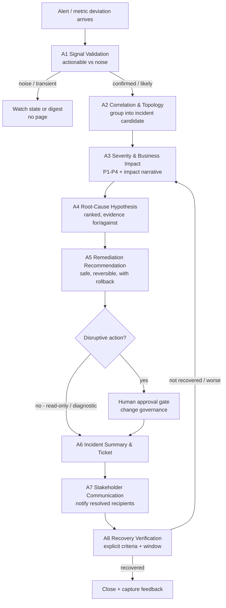

# Personas & Daily Workflow

**Project:** EventHub Ops – Sentinel
**Phase 1 artifact** — identifies the primary user persona and daily workflow, plus secondary personas.

> All names, teams, and contacts in this document are **generic placeholders** (PII-safe).
> Production ownership and on-call data come from the source-of-truth CMDB, service
> catalogue, and on-call roster.

---

## 1. Persona overview

| Persona | Role in Sentinel | Priority |
|---------|------------------|----------|
| Platform Operations on-call operator | Daily driver of the tool — triages alerts, acts on Sentinel guidance | **Primary** |
| Application / Service Owner | Owns producer/consumer behaviour; receives impact-scoped alerts; validates business effect | Secondary |
| SRE / Observability engineer | Owns telemetry quality, alert rules, SLOs; tunes Sentinel thresholds | Secondary |
| Incident Commander | Confirms severity, coordinates major incidents, owns closure criteria | Secondary |

---

## 2. Primary persona — Platform Operations on-call operator

### 2.1 Profile

| Attribute | Detail |
|-----------|--------|
| Name (placeholder) | "Priya, Platform Ops On-Call" |
| Team | Kafka / EventHub Platform Operations |
| Experience | Mixed — rotation includes senior and newer engineers |
| Environment | Business-critical banking Confluent Kafka platform (prod + preprod) |
| Primary tools today | Control Center, Grafana/Prometheus dashboards, log platform, pager, ITSM, chat |
| Shift pattern | On-call rotations, including nights/weekends |

### 2.2 Responsibilities (from requirements §3)

- Own platform health, topology, cluster configuration and runbooks.
- Perform first-line incident triage.
- Execute approved operational actions (with change governance for impactful ones).

### 2.3 Goals

- Quickly tell a real incident from noise.
- Understand business impact and who to notify without hunting through spreadsheets.
- Get an evidence-backed, safe next step — ideally a diagnostic before anything disruptive.
- Keep a clean audit trail without extra manual logging.

### 2.4 Pain points (the problem Sentinel addresses)

- **Alert noise / fatigue** — many alerts, few are actionable; duplicates across tools.
- **Slow triage** — correlating signals across Control Center, metrics, and logs by hand.
- **Specialist dependency** — root-cause reasoning often needs a specific expert who may be asleep.
- **Impact ambiguity** — hard to know, at 3 a.m., whether a lagging topic means "payments delayed" or "a dev test".
- **Stakeholder lookup** — figuring out the right App Owner / Business Owner / support team per event.

### 2.5 What the primary persona needs from Sentinel

- A validated, deduplicated incident candidate instead of raw alert spam (A1, A2).
- A proposed severity with business impact narrative and confidence (A3).
- Ranked root-cause hypotheses with evidence **for and against**, and the next discriminating check (A4).
- Safe, reversible remediation options with preconditions, verification, and rollback (A5).
- A drafted incident record and the correct recipient list, ready to send (A6, A7).
- Recovery verification against explicit criteria, not just "the alert went away" (A8).
- Clear uncertainty flags and a path to escalate to a human when evidence is thin.

### 2.6 Day-in-the-life (typical on-call shift)

1. Start shift; review the open incident queue and any watch-state items handed over.
2. A burst of alerts arrives for a topic; Sentinel has already deduplicated and correlated them into one incident candidate.
3. Read Sentinel's severity proposal and business impact (e.g., "P2 — payment settlement delayed").
4. Review ranked RCA hypotheses and run the single next diagnostic check Sentinel suggests.
5. Confirm or adjust severity; approve a safe diagnostic action; hold any disruptive action for change governance.
6. Send the drafted stakeholder notification to the resolved recipient list.
7. Monitor recovery verification; close only when closure criteria are met.
8. Leave operator feedback (severity/RCA/action usefulness) that feeds later evaluation.

### 2.7 Alert-to-resolution workflow map

---

## 3. Secondary personas

### 3.1 Application / Service Owner

| Attribute | Detail |
|-----------|--------|
| Name (placeholder) | "Arjun, Payments App Owner" |
| Responsibilities (§3) | Producer/consumer behaviour, service dependencies, retry patterns, deployment changes, business validation |
| Goals | Know immediately when their service is impacted; validate real business effect; see whether a recent deployment is implicated |
| Pain points | Gets paged late or with no business context; unclear if the issue is theirs or the platform's |
| Needs from Sentinel | Impact-scoped notifications (A7), deployment/change correlation (A2), evidence links (A6) |

### 3.2 SRE / Observability engineer

| Attribute | Detail |
|-----------|--------|
| Name (placeholder) | "Sam, SRE / Observability" |
| Responsibilities (§3) | Telemetry quality, alert rules, SLOs, dashboards, on-call routing, reliability metrics |
| Goals | Reduce false positives; keep alert rules and thresholds well-tuned; measurable reliability improvement |
| Pain points | Noisy thresholds; drift; hard to measure triage effectiveness |
| Needs from Sentinel | Precision/recall feedback, configurable thresholds (§18 FR-18), evaluation scorecards (A8 + evaluation harness) |

### 3.3 Incident Commander / Major Incident Manager

| Attribute | Detail |
|-----------|--------|
| Name (placeholder) | "Lena, Incident Commander" |
| Responsibilities (§3) | Severity confirmation, coordination, incident updates, closure criteria |
| Goals | Confident, consistent severity; concise evidence-backed updates; defensible closure |
| Pain points | Inconsistent severity calls; chasing status; incomplete audit trail |
| Needs from Sentinel | Severity rationale + confidence (A3), timeline and audit trail (A6), closure verification (A8) |

---

## 4. How personas map to Sentinel agents

| Persona | Primary agents they rely on |
|---------|-----------------------------|
| Platform Ops on-call operator | A1–A8 (full workflow) |
| App / Service Owner | A2 (change correlation), A6, A7 |
| SRE / Observability | A1, A3 (tuning), evaluation harness, A8 feedback |
| Incident Commander | A3, A6, A7, A8 |

See `problem_framing.md` for the problem statement and `events_stakeholder_summary.md`
for how impacted entities resolve to these personas for alerting.
