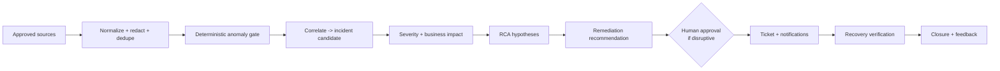

# Problem Framing — EventHub Ops Sentinel

**Project:** EventHub Ops – Sentinel
**Phase 1 artifact** — the required Problem Framing Document (1–2 page core).
**Audience:** Platform Ops, App/Service Owners, SRE, Incident Commanders, Security/Risk reviewers.

---

## 1. The exact problem to be solved

A business-critical banking platform exchanges high-volume, time-sensitive events over
Confluent Kafka. When something goes wrong — broker instability, under-replicated partitions,
rising consumer lag, connector failure, schema incompatibility, quota exhaustion, ACL/config
error, or a downstream application slowdown — it can delay or disrupt payments, fraud signals,
customer notifications, ledger updates, and other critical flows.

Today the signals that reveal these problems are scattered across many monitoring tools and
logs, a single symptom can have several plausible causes, and manual triage is slow, noisy, and
dependent on specialist knowledge that may not be available at 3 a.m.

**Sentinel solves this** by acting as a governed incident intelligence and orchestration layer
that:

- ingests alerts, logs, and health metrics from approved sources;
- validates whether a signal is an actionable anomaly or noise, and deduplicates it;
- correlates related symptoms into a single incident;
- assesses severity and **business impact** (which banking service is affected and how);
- forms ranked, evidence-backed root-cause hypotheses;
- recommends safe, reversible remediation;
- creates/updates one incident record and notifies the correct stakeholders; and
- verifies recovery and learns from operator feedback — all with a complete audit trail.

The outcome: less alert noise, faster time to detect/triage/diagnose/communicate/restore, and
one authoritative incident record per issue.

---

## 2. Design principle (non-negotiable)

> **Agents analyze and coordinate; deterministic controls enforce policy.**

The LLM is a reasoning component, not the source of truth for metrics, policy, or production
authorization. Sentinel runs **read-only / advisory by default**. Any production change
(restart, config/ACL/topic change, connector restart, offset change) requires explicit human
approval and a change record. If telemetry is stale, evidence is contradictory, or confidence
is low, Sentinel states the uncertainty and escalates to a human rather than guessing.

---

## 3. Business context

Sentinel operates over Confluent Cloud/Platform, brokers, topics, partitions, consumer groups,
producers, connectors, schemas, applications, and network/infrastructure telemetry. Rather than
forwarding every raw alert, it deduplicates and validates evidence, estimates impact, forms
multiple hypotheses, ranks recommended actions, notifies stakeholders, and learns from feedback.

- **Business outcome:** reduce alert noise and time to detect, triage, diagnose, communicate, and restore.
- **Operational outcome:** one incident record with timeline, evidence, affected assets, business services, severity, hypotheses, mitigations, owners, and updates.
- **Risk posture:** explainable recommendations, least-privilege integrations, human approval for impactful actions, no secrets or sensitive event payloads sent to an LLM.

---

## 4. In scope (initial release)

- Telemetry ingestion, normalization, deduplication, and topology/lineage enrichment.
- Anomaly validation, correlation, severity & business impact assessment.
- Evidence-backed RCA hypotheses and safe remediation **recommendations**.
- Incident record creation/update, stakeholder notification, recovery verification, feedback capture.
- Full audit trail and an operator dashboard.

## 5. Out of scope (initial release)

- Unreviewed autonomous changes to production cluster settings, ACLs, topic config, connector state, or deployments.
- Replacing existing monitoring, incident-management, change-management, or on-call systems.
- Using customer transaction payloads or PII as model context when metadata/telemetry suffice.
- Claiming a root cause as certain when evidence supports only a hypothesis.

---

## 6. The eight agents (high-level)

| ID | Agent | Responsibility |
|----|-------|----------------|
| A1 | Signal Validation / Anomaly Triage | Confirm actionable anomaly vs transient/noise; request more evidence if needed |
| A2 | Correlation & Topology | Group related signals; map impacted assets and dependent business services |
| A3 | Severity & Business Impact | Propose P1–P4 with impact narrative, confidence, escalation deadline |
| A4 | Root-Cause Hypothesis | Rank causes with evidence for/against and the next discriminating check |
| A5 | Remediation Recommendation | Propose safe, reversible actions with preconditions, verification, rollback |
| A6 | Incident Summary & Ticket | Create/update incident record idempotently |
| A7 | Stakeholder Communication & Escalation | Route notifications to approved recipients by role/severity |
| A8 | Recovery Verification & Feedback | Verify recovery against explicit criteria; capture feedback |

Detailed inputs/outputs/guardrails: see `inputs.md`, `outputs.md`, and
`events_stakeholder_summary.md`.

---

## 7. End-to-end workflow (summary)

Receive → validate & redact → normalize → deduplicate → enrich (topology, service criticality,
SLOs, recent changes, runbooks) → deterministic anomaly gate → correlate → severity/impact →
targeted diagnostics → ranked RCA hypotheses → safe recommendations → human approval gate (for
controlled actions) → ticket & notifications → verify recovery → closure summary → feedback.

Every stage is idempotent and traceable. High-criticality/security signals are never silently
dropped.

---

## 8. Example user questions (3–5)

These reflect the **primary persona** (Platform Ops on-call operator) and the questions Sentinel
must help answer:

1. **"Is this consumer-lag alert on the `payments.settlement` topic a real incident or just noise?"**
   → A1 validates the signal and reports classification + confidence with evidence.

2. **"What's the business impact and severity if the `cards.authorization` consumer group is lagging?"**
   → A3 + `events_stakeholder_summary.md` map the entity to affected services (card authorization) and propose a severity with rationale.

3. **"What are the most likely root causes, and what's the single safest check I should run first?"**
   → A4 returns ranked hypotheses with evidence for/against and the next discriminating diagnostic.

4. **"Who do I need to notify for a P2 on the `atm.withdrawals` topic, and on which channels?"**
   → A7 resolves recipients (App Owner, Business Owner, Prod Support, SRE, on-call) from the approved directory.

5. **"Has the incident actually recovered, or did the alert just stop firing?"**
   → A8 verifies recovery against explicit metric criteria over an observation window before recommending closure.

---

## 9. Why this framing matters

Getting the problem, scope, and design principle right in Phase 1 keeps later phases honest:
the agent stays advisory and evidence-grounded, business impact drives communication, and every
decision is auditable. Success criteria and how we will measure them are defined in
`success_criteria.md` and `evaluation_plan.md`; known failure modes are catalogued in
`edge_cases.md`.
